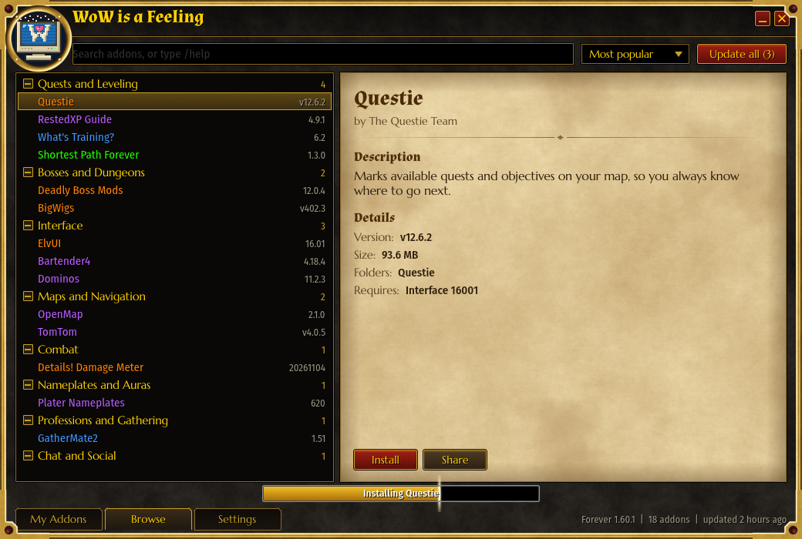

<p align="center"></p>

<h1 align="center">WoW is a Feeling</h1>

<p align="center"><b>A free, lightweight addon manager for World of Warcraft: Forever.</b><br>Browse, install and update addons without opening a website. Windows, macOS and Linux.</p>

<p align="center">
  <a href="https://github.com/robbiemueller/wow-is-a-feeling/releases/latest/download/wow-is-a-feeling-windows-x64.exe"><b>Download for Windows</b></a>
  &nbsp;|&nbsp;
  <a href="https://github.com/robbiemueller/wow-is-a-feeling/releases/latest/download/wow-is-a-feeling-macos-universal.dmg"><b>macOS</b></a>
  &nbsp;|&nbsp;
  <a href="https://github.com/robbiemueller/wow-is-a-feeling/releases/latest/download/wow-is-a-feeling-linux-x64.AppImage"><b>Linux</b></a>
</p>

<p align="center"></p>

It's one small program. There are no ads, no account and no Overwolf, and when you close it, nothing is left running. It looks like the quest log you remember.

## What it does

- **Browse without a browser.** Over 1,300 Forever addons, with their readmes, screenshots and changelogs, right in the app.
- **One click** to install, update or roll back. Removing asks you first. Addons an addon needs usually come along with it, and the app tells you about any it can't add.
- **Adopts what you have.** Addons you installed with another tool are recognized, and one click lets the app keep them updated.
- **Takes zips.** Drop a downloaded zip on the window and it installs the same safe way.
- **Looks after your settings.** It backs up your WTF folder before updating, once a day, and can restore it.
- **Updates itself, after asking.** You never have to come back here for a new version, and every update is signed.

## How small it is

| | |
|---|---|
| Download | 10 MB, one file, nothing to install |
| Memory once idle | About 35 MB |
| Memory while starting up | About 100 MB at most |
| CPU while idle | Next to none. It draws nothing until something changes. |
| Window opens in | About 0.2 seconds |
| Searching 20,000 addons | Under 10 milliseconds |
| Running after you close it | Nothing |

Measured on Windows 11 with the release build: memory with the real addon list, search with the made-up list of 20,000 the tests use. For comparison, a popular Electron-based addon manager takes 289 MB on disk on the same machine.

## The first time you open it

This app is free and isn't paying for code signing yet, so your system will warn you once.

- **Windows:** if SmartScreen appears, choose **More info**, then **Run anyway**. If Smart App Control is on, Windows blocks unsigned apps like this one and offers no Run anyway.
- **macOS:** drag the app to Applications and open it once, then go to **System Settings**, **Privacy & Security**, and choose **Open Anyway**. On macOS 12, that's **System Preferences**, **Security & Privacy**. It can only update itself from Applications, not from the disk image.
- **Linux:** make the AppImage executable, then run it. It looks for installs in the usual Wine, Lutris, Bottles, Proton and Faugus folders, and you can also pick the folder yourself.

Each release publishes its checksums and build attestations, and you can read every line of the source here.

## What it connects to

| Site | Why |
|---|---|
| GitHub | The addon list, app updates and most addon downloads |
| WoWInterface (wowinterface.com and mmoui.com) | Addons published there, with their descriptions, changelogs and screenshots |
| foreverdb.net | Only if you install ForeverDB, which is published there |
| Imgur and Postimages | Screenshots addon authors keep there |

Nothing else, apart from certificate checks your system may make for those sites, and it sends no telemetry. A link on an addon's page can't make the app contact any other site, so it can't carry a tracking pixel either.

## Why some addons are missing

Addons whose ready-to-install builds are only on CurseForge, Wago or Tukui can't be listed, because those sites don't allow it without approval. That includes Leatrix Plus, Bagnon, Auctionator, AtlasLoot and ElvUI. When you search for one, the app says so and suggests alternatives, and you can still drop a downloaded zip on the window.

Know of an addon that should be here? [Tell us](https://github.com/robbiemueller/wow-is-a-feeling/issues/new?template=add_addon.yml).

## How it keeps you safe

Addons are written by strangers, so the app treats them that way.

- No addon file it downloads is ever run. Addon code only runs inside the game, and common program and script files found in a zip are left out.
- Zips are checked before anything reaches your AddOns folder: no paths outside the folder, no links, no zip bombs.
- An install either finishes or leaves your addons exactly as they were. If the app crashes or is closed halfway, it puts things right the next time it starts.
- App updates are checked against a key built into the app before they're used.

## Platforms

| | Status |
|---|---|
| Windows 10 and 11 | Tested on Windows 11 against a real WoW Forever install. Windows 10 hasn't been tried yet. |
| Linux (Wine, Lutris, Bottles, Proton, Faugus) | Runs and passes all tests on Ubuntu. Needs glibc 2.35 or newer (Ubuntu 22.04, Debian 12, Fedora 36 or later). Finding a real install under Wine hasn't been tried yet. |
| macOS 12 or later | Runs and passes all tests in CI on a current macOS, but hasn't been tried on a real Mac with the game yet. |

If you try it on a Mac or under Wine, [let us know how it went](https://github.com/robbiemueller/wow-is-a-feeling/issues/new?template=bug_report.yml).

## Building it yourself

You need [Rust](https://rustup.rs). On Linux, also `libxkbcommon-dev`, `libgl1-mesa-dev` and `libwayland-dev`.

```bash
cargo build --release -p wow-is-a-feeling
```

| Folder | What's in it |
|---|---|
| `crates/app` | The interface |
| `crates/core` | Finding the game, installing, updating, and everything else that isn't the interface |
| `crates/catalog-builder` | Builds the addon list every 3 hours, in CI |
| `crates/xtask` | Release chores |
| `docs` | [How it's designed](docs/DESIGN.md) and [how it behaves](docs/UI-SPEC.md) |

## Credits

Named after the song "World of Warcraft is a Feeling" from [*Pure Pwnage*](https://www.youtube.com/watch?v=SpC3lZdk2HM). If you've seen it, you might go looking for a few things in here. Try `/help` in the search box.

All art is original. The fonts are Almendra, Marcellus and Fira Sans Condensed, under the SIL Open Font License.

World of Warcraft is a trademark of Blizzard Entertainment, Inc. This project is not affiliated with or endorsed by Blizzard Entertainment.

Free software under the [GPL-3.0](LICENSE).
